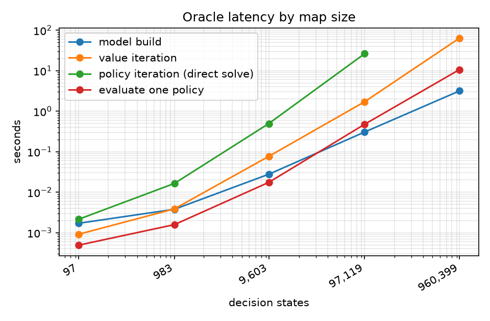
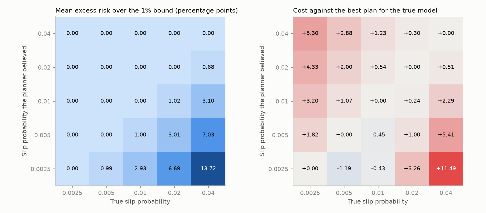

# RiskLadder

**Exact benchmarking of safe planning and learning for autonomous agents under model uncertainty.**

> Status: under construction. The environment rules are fixed in [docs/env_spec.md](docs/env_spec.md); the exact oracle, the planners (A*, penalty, constrained) and the API are done (see Results so far). Learners, safety shielding and the live demo come next.

## The problem

An autonomous rover knows its map but not exactly how it moves: it may slip, and entering a hazard loses it. Should it plan with a model or learn from experience? How can it learn without being destroyed while learning? And if the model it trusts is wrong, how much does that cost?

RiskLadder answers these questions with **exact ground truth**. The environment is small enough to solve exactly, so every agent's true regret and true probability of failure are computed in closed form instead of estimated from noisy rollouts.

## The ladder

Each rung removes one piece of knowledge from the agent.

| Rung | What the agent knows | Agents |
|---|---|---|
| 1 | Deterministic dynamics, full model | A* |
| 2 | Stochastic dynamics, full model | Value / policy iteration, constrained MDP (Lagrangian) |
| 3 | Stochastic dynamics, no model | Q-learning, SARSA, linear Q-learning |
| 4 | Map known, probabilities unknown | Model-based RL, safety shield, reward shaping from the map |

## Planned claims

1. **Exact oracle:** expected cost and failure probability of any policy, exactly and faster than Monte Carlo at small risk levels.
2. **A penalty is not a constraint:** one fixed failure penalty gives very different risk across maps and noise levels; a constrained MDP holds `P(fail) ≤ δ` on every map at minimum cost. Model misspecification breaks that guarantee by a measurable amount.
3. **Prior knowledge buys back the cost of learning:** map-based shielding, shaping and structured models reduce failures during training at little cost in regret, and map features generalise to unseen maps.

## Results so far

### Exact evaluation versus Monte Carlo (E0)

E0: exact evaluation vs Monte Carlo on `dilemma-30x30-s0.map` (shortest route (1-cell moves toward the goal)).

Rollouts needed for a +-10% relative error at 95% confidence (coverage is measured over 300 repeated runs of that size).

| P(fail) exact | MC rollouts | MC time | Coverage | Oracle time | Speed-up |
|---|---|---|---|---|---|
| 0.1000 | 3,458 | 0.00 s | 96% | 0.2 ms | 18x |
| 0.0100 | 38,032 | 0.04 s | 95% | 0.2 ms | 196x |
| 0.0010 | 383,776 | 0.36 s | 96% | 0.2 ms | 2,043x |

The oracle returns the exact failure probability of a policy in about a fifth of a millisecond on this map. A Monte Carlo estimate needs a number of rollouts proportional to `1 / P(fail)` for the same relative accuracy, so the gap grows as risks get smaller. Both agree: the measured coverage of the +-10% interval matches the nominal 95% (Coverage column). Reproduce with `uv run python -m experiments.e0`.

### Oracle latency by map size

| Grid | States | Build | VI (iterations) | PI (iterations) | Evaluate | Peak memory |
|---|---|---|---|---|---|---|
| 12x12 | 97 | 0.00 s | 0.00 s (69) | 0.00 s (7) | 0 ms | 67 MB |
| 34x34 | 983 | 0.00 s | 0.00 s (120) | 0.02 s (12) | 2 ms | 69 MB |
| 102x102 | 9,603 | 0.03 s | 0.08 s (318) | 0.49 s (23) | 17 ms | 134 MB |
| 320x320 | 97,119 | 0.31 s | 1.71 s (724) | 26.27 s (53) | 475 ms | 2,488 MB |
| 1002x1002 | 960,399 | 3.17 s | 63.80 s (2449) | skipped | 10657 ms | 2,525 MB |

Measured on macOS-26.5.1-arm64-arm-64bit (arm64), Python 3.12.16, NumPy 2.5.5, SciPy 1.18.1.



Value iteration and policy evaluation scale to about a million states. Policy iteration uses a direct sparse solve and is limited to about 10^5 states by memory. Reproduce with `uv run python -m bench.latency`.

### A failure penalty is not a risk constraint (E3)

E3: a failure penalty is not a risk constraint.

Penalty price tuned on map 0 at slip 0.01 to meet a 1% bound (extra price 130.6 on top of the environment's failure cost), then reused unchanged.

| Slip | Maps | Penalty breaks the bound | Worst penalty P(fail) | Constrained worst P(fail) | Extra cost of the penalty where it is safe |
|---|---|---|---|---|---|
| 0.005 | 12 | 7 of 12 | 1.98% | 1.00% | +0.24 |
| 0.01 | 12 | 3 of 12 | 1.48% | 1.00% | +0.48 |
| 0.02 | 12 | 0 of 12 | 0.00% | 1.00% | +0.33 |

Expected cost against tail cost along the frontier (map 0, slip 0.01). CVaR is the mean mission cost of the worst 5% of successful missions.

| Bound | P(fail) | Expected cost | Mean mission cost | CVaR 0.95 (95% interval) |
|---|---|---|---|---|
| none | 3.91% | 29.44 | 24.85 | 30.80 (30.76 to 30.85) |
| 3% | 3.00% | 29.48 | 25.97 | 32.23 (32.18 to 32.27) |
| 1% | 1.00% | 29.59 | 28.37 | 33.56 (33.52 to 33.60) |
| 0.3% | 0.30% | 30.50 | 30.14 | 35.33 (35.29 to 35.38) |
| 0% | 0.00% | 30.91 | 30.91 | 35.88 (35.84 to 35.92) |


The penalty planner can only reach the corners of the cost/risk curve, one policy per price, while the constrained solver reaches every point on the segments between them. A penalty tuned to meet a 1% bound on one map then breaks that bound on other maps at the same noise level, and at other noise levels, while the constrained solver holds 1% on every map; where the penalty happens to be safe it is also more expensive.


Reproduce with `uv run python -m experiments.e3`.

### What a wrong slip estimate costs (E2)

E2: planning with the wrong slip probability (bound 1%, 12 ridge maps, exact scoring under the true model).

Planning with a margin: the believed slip is multiplied by the margin before planning. Cells show the mean excess risk over the 1% bound, in percentage points, when the belief is the true slip divided by the factor, and the extra cost when the belief is right.

| Margin | Belief low by 1.5x | Belief low by 2x | Belief low by 3x | Belief right: extra cost |
|---|---|---|---|---|
| 1x | 0.38 | 0.92 | 1.81 | +0.000 |
| 2x | 0.00 | 0.00 | 0.38 | +0.747 |
| 4x | 0.00 | 0.00 | 0.00 | +1.846 |



A planner that believes the rover slips less than it does breaks the risk bound, by up to 13.7 percentage points in the worst cell; one that believes it slips more keeps the bound but pays for it. Planning with a safety margin on the slip probability removes the violation for an underestimate up to the margin and costs more when the estimate was right. Reproduce with `uv run python -m experiments.e2`.

### The API

`POST /plan` returns the cheapest policy with the failure probability bounded exactly, certified optimal by a dual bound; `POST /evaluate` scores a policy you bring. See [docs/api.md](docs/api.md) for the endpoints, limits, measured latency and deployment.

## Development

Requires [uv](https://docs.astral.sh/uv/).

```bash
uv sync
uv run pytest
uv run ruff check . && uv run ruff format --check .
```

The testing strategy (reference implementation, metamorphic and property tests, fuzzing, mutation check) is described in [docs/testing.md](docs/testing.md).

## License

MIT
