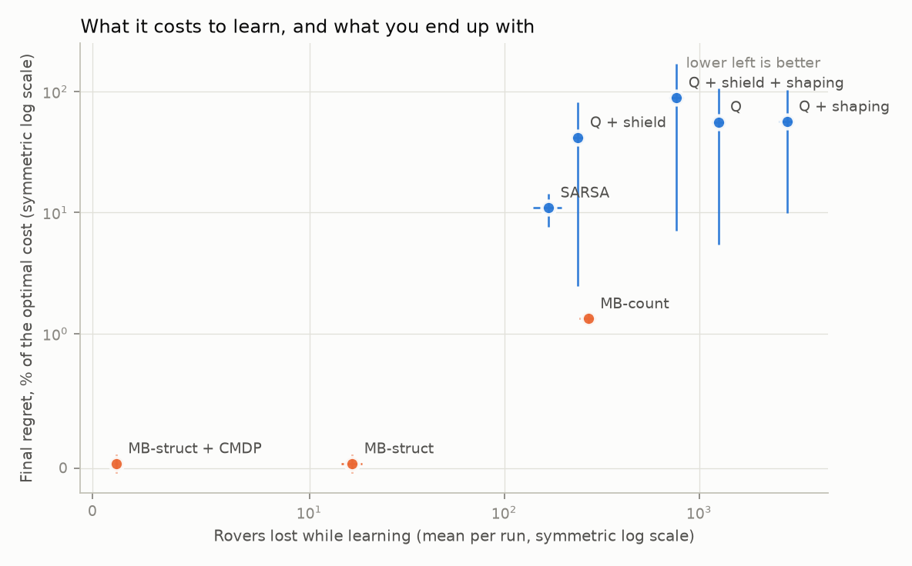
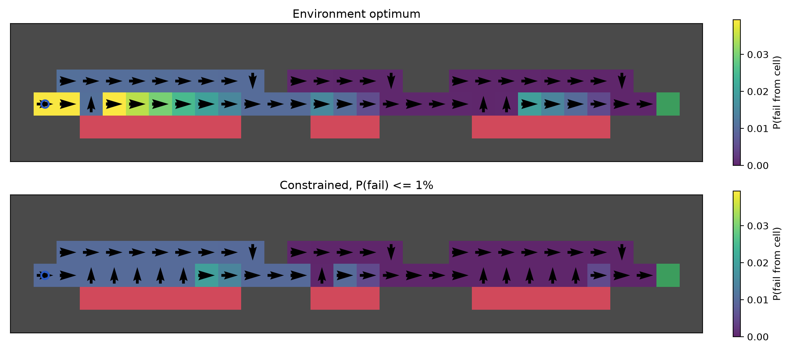

# Risk-Bounded-Autonomy

[](https://github.com/BrianTr9/Risk-Bounded-Autonomy/actions/workflows/ci.yml)

How much does an AI agent lose while it learns a dangerous job, and what makes it lose less? This project answers with exact numbers, using a rover that must cross a hazard map without being destroyed. It compares planning, reinforcement learning and model-based learning, and measures risk by computation instead of simulation.

Python (NumPy, SciPy), FastAPI, Gradio, Docker, more than 880 tests, CI/CD to a live demo: https://briantr9-risk-ladder.hf.space (free Space, so the first request after a quiet period can take a minute). Read the [write-up](docs/writeup.md) first, then the [design decisions](docs/decisions.md). Every number below comes from `results/` (see [results/SUMMARY.md](results/SUMMARY.md), generated).



Each dot is one way of learning the same ten maps (five runs per map). Further left means fewer rovers destroyed while learning, lower means closer to the best possible plan at the end. The structured model that plans under a risk bound (bottom left) lost 1 rover on average where Q-learning lost 1,252.

The live demo plans a mission for a map you pick or generate. This is its output for the first example map, comparing the environment's own optimum with a plan whose failure probability is bounded at 1%. Arrows are the policy, colour is the probability of losing the rover from each cell (one scale for both panels), red cells are hazards and the green cell is the goal. The optimum loses the rover with probability 3.91% at an expected cost of 29.44; the bounded plan loses it with probability 1.00% at 29.59.



## The problem

A rover knows its map but not exactly how it moves: it may slip sideways, and entering a hazard loses it. Should it plan with a model or learn from experience? How can it learn without being destroyed while learning? And if the model it trusts is wrong, how much does that cost?

The maps are small enough to solve exactly, so every agent's regret and every failure probability are computed in closed form instead of estimated from noisy rollouts.

Terms used below:

| Term | Meaning |
|---|---|
| Regret | How much more the agent's expected cost is than the best possible, as a percentage |
| P(fail) | The probability that the rover is lost |
| Oracle | The exact computation of a policy's cost and P(fail), with no simulation |
| Constrained MDP | The planning problem of finding the cheapest plan whose P(fail) stays under a bound |
| Safety shield | A rule that blocks actions that could lose the rover in one step |
| Model-free, model-based | Learning values directly from samples, or learning a model of the world and then planning on it |

## The ladder

Each rung removes one piece of knowledge from the agent. The rungs also mark where the problem gets harder: stochastic transitions (rung 2), no model (rung 3), and a model that must be learned while staying safe (rung 4).

| Rung | What the agent knows | Agents |
|---|---|---|
| 1 | Deterministic dynamics, full model | A* |
| 2 | Stochastic dynamics, full model | Value and policy iteration, constrained MDP (Lagrangian) |
| 3 | Stochastic dynamics, no model | Q-learning, SARSA, linear Q-learning |
| 4 | Map known, probabilities unknown | Model-based RL, safety shield, reward shaping from the map |

## Claims

1. The oracle gives the expected cost and the failure probability of any policy exactly. At a failure probability of 0.001 it takes 0.17 ms, where a Monte Carlo estimate accurate to 10% needs 383,776 rollouts, 2,043 times as long ([E0](docs/results.md#exact-evaluation-versus-monte-carlo-e0)).
2. A penalty is not a constraint. One fixed failure price broke a 1% bound on 7 of 12 maps (worst 1.98%); the constrained solver met it on all 12 at the minimum cost, with a certificate of optimality ([E3](docs/results.md#a-failure-penalty-is-not-a-risk-constraint-e3)). A planner that believes the slip is 16 times lower than it is exceeds the bound by 13.7 percentage points ([E2](docs/results.md#what-a-wrong-slip-estimate-costs-e2)).
3. Prior knowledge buys back the cost of learning. A structured model lost 17 rovers while learning against 1,252 for Q-learning, and 1 when planning under a risk bound; a safety shield cut a model-free learner's losses about fivefold; features computed from the map carry over to unseen maps with a median regret of 18.7% ([E1](docs/results.md#what-prior-knowledge-buys-back-e1), [E4](docs/results.md#learning-from-samples-e4)). Reward shaping lost more rovers when its potential followed the shortest route (which hugs the hazards) and about five times fewer when it followed a route that keeps clear of them, 252 against 1,252 ([E1c](docs/results.md#which-potential-should-shaping-follow-e1c)).

The numbers hold for the generated map families in `experiments/maps/`, which are grid worlds, not real vehicles.

## Quickstart

As a library (the Python package is called `riskladder`):

```python
from riskladder.env import build_model, load_map
from riskladder.agents import solve_cmdp

mdp = build_model(load_map("experiments/maps/ridge/ridge-6x30-s3000.map"))
plan = solve_cmdp(mdp, 0.01)  # cheapest plan whose failure probability is at most 1%
print(plan.result)  # exact cost and probabilities of that plan
```

As an API (`uv sync --extra app` first):

```bash
uv run uvicorn app.main:app --port 7860
python3 -c 'import json,sys; print(json.dumps({"map": open(sys.argv[1]).read(), "delta": 0.01}))' \
  experiments/maps/ridge/ridge-6x30-s3000.map | curl -s localhost:7860/plan -H 'content-type: application/json' -d @-
```

As the demo: `uv sync --extra app --extra demo --extra exp`, run the same `uvicorn` command and open http://localhost:7860/demo, or use the live link above. Endpoints, limits and deployment are in [docs/api.md](docs/api.md).

## Who this is for

The repository is a measured study with a small toolkit, not a library for real vehicles. It is for someone who wants to see how the risk of a learning or planning agent can be measured exactly and what recovers it; for someone benchmarking their own learner (five methods are enough, see [docs/learning.md](docs/learning.md)); and for someone who needs a plan with a certified failure bound on a grid map (the API, up to 2,500 cells). The experiments are small grid worlds, so the numbers say nothing about a physical vehicle.

## Design decisions

The short version follows; [docs/decisions.md](docs/decisions.md) gives each decision with the alternative I passed over, the evidence, and a list of what I got wrong first.

The environment is a grid because its states can be enumerated, which makes the exact oracle possible; the cost is that nothing here involves continuous state or perception.

Failure has a price inside the environment's cost, `C_fail` (5 times the longest hazard-free route times the move cost), and is also tracked as a probability. Without the price every optimiser would walk into a hazard early, since entering one ends the episode with a small cost. With it, the probability is free to be constrained separately.

Planning is a stochastic shortest path problem with no discounting, so a policy that never ends has infinite cost. Evaluation uses a finite horizon and reports the probability of a timeout, so a policy that loops is charged for it.

A constrained solution needs a mixture of two policies because the failure probability of the optimal Lagrangian policy jumps as the multiplier grows. The optimum sits at a jump, and mixing the two policies on either side, chosen once per episode, meets the bound exactly.

The shield bounds the risk of each step under an assumed slip bound. It does not bound the risk of an episode, and it relaxes its own threshold in cells where no safe route exists.

The structured model learner knows the geometry of the map and learns the slip probabilities and costs. It is not a fair comparison with a learner that knows nothing; the count-based model learner is there so that the gap between them is the value of the map.

## Limitations

The environment is small and the noise is a single sideways slip. The shield assumes a known upper bound on the slip, and the constrained planner's guarantee holds only if its model is right. The learners are tabular or linear; there is no deep reinforcement learning. Tail risk (CVaR) is a Monte Carlo estimate. The step sizes were tuned on a small grid and the best values lie on its edge. The shaping scales in E1c are not tuned, and the clear-of-hazards potential assumes the map has a route that keeps clear of hazards (the dilemma maps do; E1c was not run on the ridge maps).

## Reproduce

```bash
uv sync
uv run python -m experiments.run all --smoke   # about a minute: tiny versions, written to results/smoke/
uv run python -m experiments.run all           # every experiment and results/SUMMARY.md (tens of minutes)
uv run python -m experiments.run list          # the experiments and what each shows
```

## Evidence

Each experiment has its table, figure and reading in [docs/results.md](docs/results.md); the headline numbers are collected in [results/SUMMARY.md](results/SUMMARY.md). The API, the demo and the deployment are described in [docs/api.md](docs/api.md).

## Development

Requires [uv](https://docs.astral.sh/uv/).

```bash
uv sync
uv run pytest
uv run ruff check . && uv run ruff format --check .
```

The testing strategy (reference implementation, metamorphic and property tests, fuzzing, mutation check) is described in [docs/testing.md](docs/testing.md).

## License

MIT
