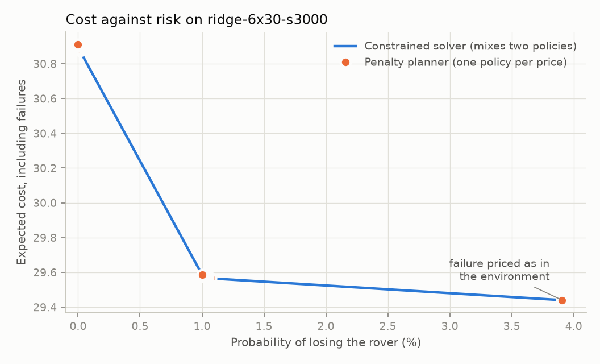
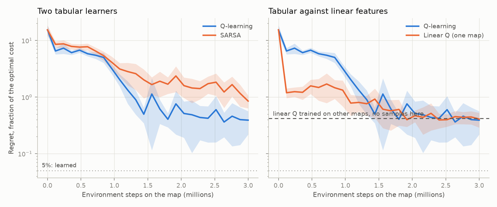
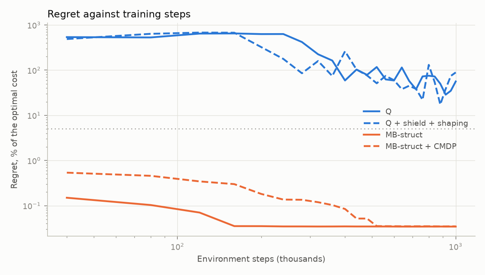

# RiskLadder

**Exact benchmarking of safe planning and learning for autonomous agents under model uncertainty.**

> Status: under construction. The environment rules are fixed in [docs/env_spec.md](docs/env_spec.md); the exact oracle, the planners (A*, penalty, constrained) and the API are done (see Results so far). Learners, safety shielding and the live demo come next.

## The problem

An autonomous rover knows its map but not exactly how it moves: it may slip, and entering a hazard loses it. Should it plan with a model or learn from experience? How can it learn without being destroyed while learning? And if the model it trusts is wrong, how much does that cost?

RiskLadder answers these questions with **exact ground truth**. The environment is small enough to solve exactly, so every agent's true regret and true probability of failure are computed in closed form instead of estimated from noisy rollouts.

## The ladder

Each rung removes one piece of knowledge from the agent.

| Rung | What the agent knows | Agents |
|---|---|---|
| 1 | Deterministic dynamics, full model | A* |
| 2 | Stochastic dynamics, full model | Value / policy iteration, constrained MDP (Lagrangian) |
| 3 | Stochastic dynamics, no model | Q-learning, SARSA, linear Q-learning |
| 4 | Map known, probabilities unknown | Model-based RL, safety shield, reward shaping from the map |

## Planned claims

1. **Exact oracle:** expected cost and failure probability of any policy, exactly and faster than Monte Carlo at small risk levels.
2. **A penalty is not a constraint:** one fixed failure penalty gives very different risk across maps and noise levels; a constrained MDP holds `P(fail) ≤ δ` on every map at minimum cost. Model misspecification breaks that guarantee by a measurable amount.
3. **Prior knowledge buys back the cost of learning:** map-based shielding, shaping and structured models reduce failures during training at little cost in regret, and map features generalise to unseen maps.

## Results so far

### Exact evaluation versus Monte Carlo (E0)

E0: exact evaluation vs Monte Carlo on `dilemma-30x30-s0.map` (shortest route (1-cell moves toward the goal)).

Rollouts needed for a +-10% relative error at 95% confidence (coverage is measured over 300 repeated runs of that size).

| P(fail) exact | MC rollouts | MC time | Coverage | Oracle time | Speed-up |
|---|---|---|---|---|---|
| 0.1000 | 3,458 | 0.00 s | 96% | 0.2 ms | 18x |
| 0.0100 | 38,032 | 0.04 s | 95% | 0.2 ms | 196x |
| 0.0010 | 383,776 | 0.36 s | 96% | 0.2 ms | 2,043x |

The oracle returns the exact failure probability of a policy in about a fifth of a millisecond on this map. A Monte Carlo estimate needs a number of rollouts proportional to `1 / P(fail)` for the same relative accuracy, so the gap grows as risks get smaller. Both agree: the measured coverage of the +-10% interval matches the nominal 95% (Coverage column). Reproduce with `uv run python -m experiments.e0`.

### Oracle latency by map size

| Grid | States | Build | VI (iterations) | PI (iterations) | Evaluate | Peak memory |
|---|---|---|---|---|---|---|
| 12x12 | 97 | 0.00 s | 0.00 s (69) | 0.00 s (7) | 0 ms | 67 MB |
| 34x34 | 983 | 0.00 s | 0.00 s (120) | 0.02 s (12) | 2 ms | 69 MB |
| 102x102 | 9,603 | 0.03 s | 0.08 s (318) | 0.49 s (23) | 17 ms | 134 MB |
| 320x320 | 97,119 | 0.31 s | 1.71 s (724) | 26.27 s (53) | 475 ms | 2,488 MB |
| 1002x1002 | 960,399 | 3.17 s | 63.80 s (2449) | skipped | 10657 ms | 2,525 MB |

Measured on macOS-26.5.1-arm64-arm-64bit (arm64), Python 3.12.16, NumPy 2.5.5, SciPy 1.18.1.


Value iteration and policy evaluation scale to about a million states. Policy iteration uses a direct sparse solve and is limited to about 10^5 states by memory. Reproduce with `uv run python -m bench.latency`.

### A failure penalty is not a risk constraint (E3)

E3: a failure penalty is not a risk constraint.

Penalty price tuned on map 0 at slip 0.01 to meet a 1% bound (extra price 130.6 on top of the environment's failure cost), then reused unchanged.

| Slip | Maps | Penalty breaks the bound | Worst penalty P(fail) | Constrained worst P(fail) | Extra cost of the penalty where it is safe |
|---|---|---|---|---|---|
| 0.005 | 12 | 7 of 12 | 1.98% | 1.00% | +0.24 |
| 0.01 | 12 | 3 of 12 | 1.48% | 1.00% | +0.48 |
| 0.02 | 12 | 0 of 12 | 0.00% | 1.00% | +0.33 |

Expected cost against tail cost along the frontier (map 0, slip 0.01). CVaR is the mean mission cost of the worst 5% of successful missions.

| Bound | P(fail) | Expected cost | Mean mission cost | CVaR 0.95 (95% interval) |
|---|---|---|---|---|
| none | 3.91% | 29.44 | 24.85 | 30.80 (30.76 to 30.85) |
| 3% | 3.00% | 29.48 | 25.97 | 32.23 (32.18 to 32.27) |
| 1% | 1.00% | 29.59 | 28.37 | 33.56 (33.52 to 33.60) |
| 0.3% | 0.30% | 30.50 | 30.14 | 35.33 (35.29 to 35.38) |
| 0% | 0.00% | 30.91 | 30.91 | 35.88 (35.84 to 35.92) |



The penalty planner can only reach the corners of the cost/risk curve, one policy per price, while the constrained solver reaches every point on the segments between them. A penalty tuned to meet a 1% bound on one map then breaks that bound on other maps at the same noise level, and at other noise levels, while the constrained solver holds 1% on every map; where the penalty happens to be safe it is also more expensive.


Reproduce with `uv run python -m experiments.e3`.

### What a wrong slip estimate costs (E2)

E2: planning with the wrong slip probability (bound 1%, 12 ridge maps, exact scoring under the true model).

Planning with a margin: the believed slip is multiplied by the margin before planning. Cells show the mean excess risk over the 1% bound, in percentage points, when the belief is the true slip divided by the factor, and the extra cost when the belief is right.

| Margin | Belief low by 1.5x | Belief low by 2x | Belief low by 3x | Belief right: extra cost |
|---|---|---|---|---|
| 1x | 0.38 | 0.92 | 1.81 | +0.000 |
| 2x | 0.00 | 0.00 | 0.38 | +0.747 |
| 4x | 0.00 | 0.00 | 0.00 | +1.846 |


A planner that believes the rover slips less than it does breaks the risk bound, by up to 13.7 percentage points in the worst cell; one that believes it slips more keeps the bound but pays for it. Planning with a safety margin on the slip probability removes the violation for an underestimate up to the margin and costs more when the estimate was right. Reproduce with `uv run python -m experiments.e2`.

### Learning from samples (E4)

E4: tabular Q-learning, SARSA and a linear Q-learner on map-only features learn the 20 held-out 30 x 30 `field` maps from sampled steps (3 seeds per map, 3,000,000 steps). Every checkpoint is scored exactly by the oracle. Regret is a fraction of the optimal cost and is heavy-tailed (a policy that loops pays its step costs until the horizon), so the median and quartiles are reported next to the mean, and the runs whose final policy loops are counted.

| Agent | Final regret: median [quartiles] (mean) | Runs that loop | P(fail) | Failures while training |
|---|---|---|---|---|
| Q-learning | 18.3% [12.6 to 33.7] (mean 39%) | 1 of 60 | 1.8% | 57,234 |
| SARSA | 57.9% [34.2 to 85.8] (mean 85%) | 2 of 60 | 7.3% | 50,070 |
| Linear Q, one map | 20.6% [9.5 to 59.4] (mean 41%) | 2 of 60 | 5.3% | 61,815 |
| Linear Q, trained on 20 other maps, **0 samples here** | 18.7% [8.7 to 48.2] (mean 42%) | 0 of 100 | 3.2% | n/a |




A linear learner with ten map-only features, trained across 20 other maps, ends with about the same median regret on a new map as Q-learning after 3 million steps on that map. Matching the per-map mean regret, Q-learning needs a median of 1.56 million steps (it gets there within 3 million on 15 of 20 maps). The honest limits: the spread is wide (quartiles 8.7% to 48.2%) and a few maps are far from optimal; the linear learner's features, not its samples, limit it (training on the map itself does not beat zero-shot); no learner reached the 5% threshold in most runs; and the step sizes were tuned lightly on a small grid, with the best values at the edge of it. Reproduce with `uv run python -m experiments.e4`; see [docs/learning.md](docs/learning.md).

### What prior knowledge buys back (E1)

E1: eight ways to learn the ten 30 x 30 `dilemma` maps (5 seeds each, 1,000,000 steps, same budget and seeds for all), scored exactly by the oracle. Regret is a fraction of the optimal cost (median and quartiles, with the mean in brackets because a few looping policies inflate it); "learned" means at most 5%.

| Configuration | Rovers lost while learning | Final regret: median [quartiles] (mean) | Runs that loop | Learned |
|---|---|---|---|---|
| Q | 1,252 ± 104 | 12.0% [8.0 to 24.0] (mean 56%) | 3 of 50 | 12% |
| SARSA | 168 ± 28 | 6.7% [5.5 to 9.8] (mean 11%) | 0 of 50 | 72% |
| Q + shaping | 2,815 ± 250 | 12.3% [9.4 to 30.9] (mean 57%) | 3 of 50 | 24% |
| Q + shield | 239 ± 17 | 12.0% [8.9 to 32.9] (mean 42%) | 1 of 50 | 14% |
| Q + shield + shaping | 764 ± 70 | 12.9% [9.2 to 42.0] (mean 89%) | 3 of 50 | 28% |
| MB-count (no map knowledge) | 270 ± 26 | 1.3% [0.9 to 1.6] (mean 1%) | 0 of 50 | 100% |
| MB-struct (knows the geometry) | 17 ± 2 | 0.0% [0.0 to 0.0] (mean 0%) | 0 of 50 | 100% |
| MB-struct + constrained planning | 1 ± 0 | 0.0% [0.0 to 0.0] (mean 0%) | 0 of 50 | 100% |




What the numbers say, including the parts that did not go as planned:

- Knowing the map's geometry and learning only the hidden slip probabilities and costs loses 98.7% fewer rovers than Q-learning (17 against 1,252) and learns in 40,000 steps; planning under a failure-probability bound loses one on average. A model-based learner that knows nothing of the map (MB-count) already beats every model-free variant on both axes, so most of the gain comes from planning on a learned model, and the map adds a further 16x fewer rovers lost.
- The shield works as intended on its own: Q + shield loses 5x fewer rovers than Q (239 against 1,252) at the same median regret. It bounds the risk of each step, not the probability of failing over an episode.
- Shaping did **not** help here. Q + shaping lost more rovers than Q (2,815 against 1,252) at the same median regret, and the shaping scale chosen by tuning (2.0) sat at the edge of the grid. I have not isolated why. Shaping preserves the optimal policy (checked against the oracle) but not the safety of the learning process.
- SARSA is the best model-free learner on these maps, but see E1b: that does not carry over to the ridge maps.
- On these maps the optimum already avoids the corridor, so the shield costs little in regret here; E1b tests maps where the best policy accepts some risk.

Reproduce with `uv run python -m experiments.e1`; see [docs/learning.md](docs/learning.md).

### Does the shield help once the learner is SARSA? (E1b)

E1 compared the shield only with Q-learning, on maps where the safe route is already the best one. E1b adds SARSA with each prior, a second map family where the best policy accepts a small risk (`ridge`: the optimum loses the rover with probability 3%), step sizes and the shaping scale retuned on maps of each family (not evaluation maps), and a sweep of the true slip probability.


Rovers lost while learning; final regret as median [quartiles]; runs whose final policy loops:

| Configuration | dilemma (10 maps) | ridge (12 maps) |
|---|---|---|
| Q | 1,252; 12.0% [8.0 to 24.0]; 3 of 50 | 7,245; 16.0% [13.3 to 22.4]; 1 of 36 |
| SARSA | 168; 6.7% [5.5 to 9.8]; 0 of 50 | 4,507; 20.2% [10.5 to 322]; **9 of 36** |
| SARSA + shield | 68; 6.7% [5.2 to 8.9]; 1 of 50 | **0**; 7.4% [5.3 to 10.3]; 0 of 36 |
| SARSA + shaping | 269; 11.5% [8.7 to 18.1]; 0 of 50 | 4,878; 18.1% [11.0 to 172]; 9 of 36 |
| Q + shield | 239; 12.0% [8.9 to 32.9]; 1 of 50 | **0**; 14.2% [11.9 to 17.8]; 0 of 36 |
| Model-based + constrained planning | 1; 0.0%; 0 of 50 | 121; 2.6% [1.8 to 3.1]; 0 of 36 |

- **The shield does help, and E1 understated it.** On ridge maps SARSA loses thousands of rovers and in a quarter of the runs (9 of 36) ends with a policy that loops until the horizon, which is what makes its mean regret 438% while its median is 20%. SARSA + shield loses no rovers, never loops, and has a median regret of 7%. On dilemma maps it cuts SARSA's losses 2.5x (168 to 68) at the same median regret. The slip sweep agrees: at slip 0.05, 113 to 10 rovers lost; at 0.3, 216 to 154.
- **Caution has a price where the optimum takes risk.** On ridge maps the optimal policy fails 3% of the time; the shielded learners fail 0%, and their median regret (7 to 14%) includes that price. The constrained planner, given a 1% bound, lands at 1.0% failure and 2.6% regret, which is the better trade, at the cost of knowing the geometry.
- **SARSA is not safe by itself.** It looked safe on the dilemma maps because the best route there is the safe one.
- **Shaping did not help in any setting** (dilemma: higher median regret for SARSA; ridge: no change). The tuned scale is again at the edge of the grid. The tuning objective (mean regret over the whole run) rewards early speed, so a candidate explanation is that it picked a scale that is fast early and worse at the end; I have not tested that, so shaping stays in the repository as an honest negative result rather than as a claimed benefit.
- **A wrong assumed bound is visible.** At true slip 0.3 a dash slips with probability 0.6, above the 0.4 the shield and the planner assume, and the constrained planner's median regret rises to 35% (its failure probability stays 0%).

Reproduce with `uv run python -m experiments.e1b`.

### The API

`POST /plan` returns the cheapest policy with the failure probability bounded exactly, certified optimal by a dual bound; `POST /evaluate` scores a policy you bring. See [docs/api.md](docs/api.md) for the endpoints, limits, measured latency and deployment.

## Development

Requires [uv](https://docs.astral.sh/uv/).

```bash
uv sync
uv run pytest
uv run ruff check . && uv run ruff format --check .
```

The testing strategy (reference implementation, metamorphic and property tests, fuzzing, mutation check) is described in [docs/testing.md](docs/testing.md).

## License

MIT
