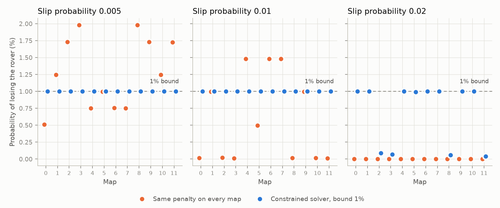
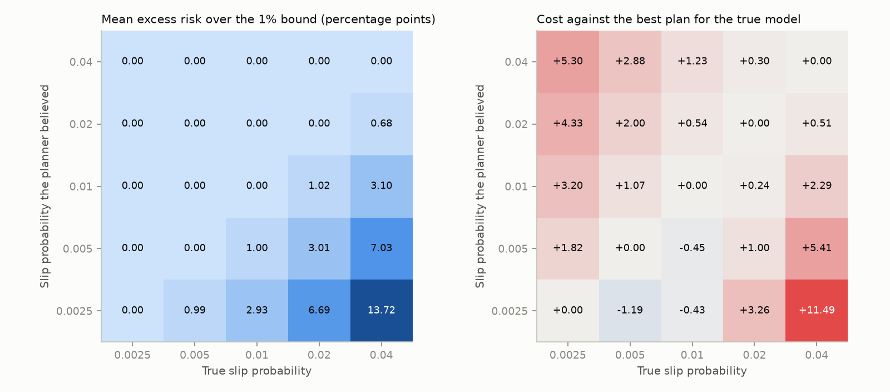
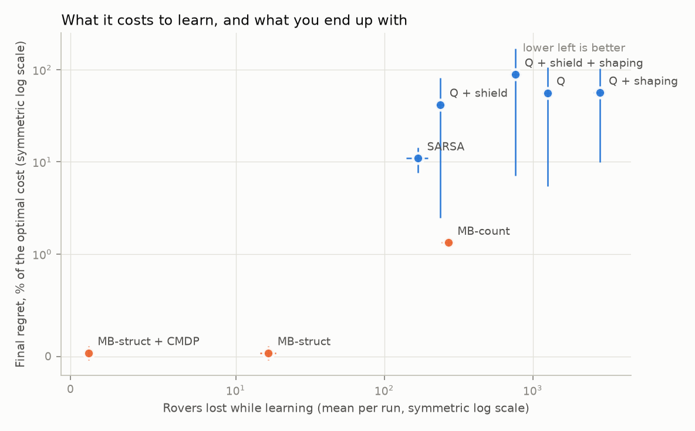
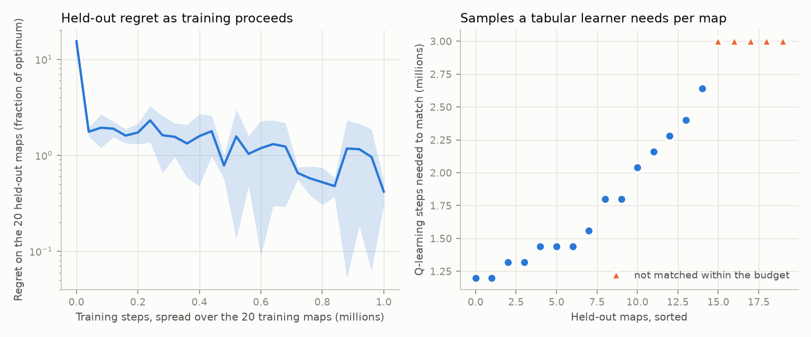
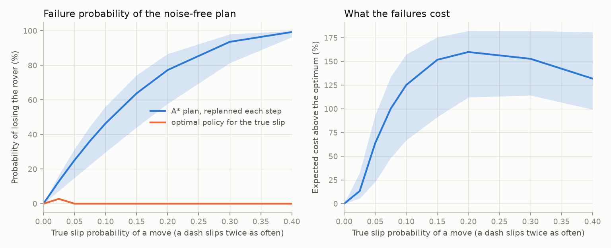
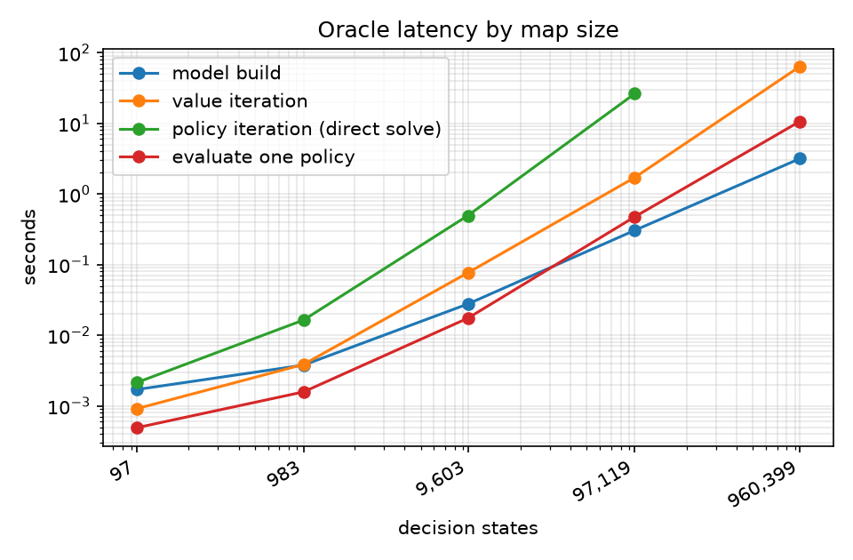
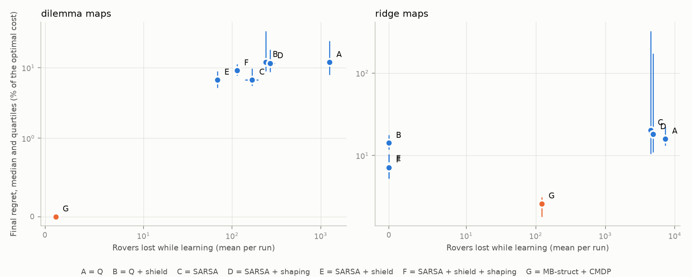

# RiskLadder: results summary

Generated by `uv run python -m experiments.summary`; every number comes from the `results/*.json` files written by the experiments.

## Headline figures

### Penalty versus constraint (E3)

*Does one fixed failure penalty give the same risk everywhere?*

- At slip 0.005, one fixed penalty breaks the 1% bound on 7 of 12 maps (worst 1.98%); the constrained solver breaks it on 0 (worst 1.00%).
- At slip 0.01, one fixed penalty breaks the 1% bound on 3 of 12 maps (worst 1.48%); the constrained solver breaks it on 0 (worst 1.00%).
- At slip 0.02, one fixed penalty breaks the 1% bound on 0 of 12 maps (worst 0.00%); the constrained solver breaks it on 0 (worst 1.00%).

### A wrong slip estimate (E2)

*How much does a wrong model break the risk guarantee, and what does a margin buy?*

- A planner that believes the slip is 16x lower than it is exceeds the 1% bound by 13.7 percentage points on average in the worst cell of the grid.
- Planning with a 2x margin removes the excess for a 2x underestimate and costs 0.75 extra when the belief was right.

### What prior knowledge buys back (E1)

*How many rovers does learning lose, and what does each kind of prior knowledge change?*

- Rovers lost while learning (mean per run): Q 1,252, SARSA 168, Q + shield 239, MB-count 270, MB-struct 17, MB-struct + CMDP 1.
- Q + shaping lost 2,815, more than Q.
- Final median regret: Q 12.0%, SARSA 6.7%, Q + shaping 12.3%, Q + shield 12.0%, Q + shield + shaping 12.9%, MB-count 1.3%, MB-struct 0.0%, MB-struct + CMDP 0.0%.

### Generalisation to new maps (E4)

*Do map-only features carry over to maps the learner never saw?*

- Trained on other maps and given no samples on the new one, the linear learner's median regret is 18.7% (quartiles 8.7% to 48.2%).
- Q-learning matches it per map within 3,000,000 steps on 15 of 20 maps; median steps to match: 1,560,000.

## Supporting results

### The first rung: A* (E5)

*What does planning for a rover that never slips cost when it does?*

- At slip 0.15 the noise-free A* plan loses the rover with probability 63.8% (maps range 44.1% to 74.3%) and costs a median 152% more than the optimum, which loses it with probability 0.0%.

### Exact versus Monte Carlo (E0)

*Is exact evaluation worth having?*

- At P(fail) = 0.001 the exact evaluation takes 0.17 ms; a Monte Carlo estimate to +-10% needs 383,776 rollouts, 2,043x slower, and its interval covers the truth 96% of the time.

### Oracle latency

*How large a map can the oracle solve?*

- The largest grid, 1002x1002 with 960,399 states, is solved by value iteration in 63.8 s.

### Shield on SARSA (E1b)

*Does the shield help once the learner is SARSA?*

- On ridge maps SARSA's final policy loops in 9 of 36 runs and loses 4,507 rovers; with the shield, 0 of 36 loop and 0 are lost.

Further figures: `figures/e3_frontier.png`, `figures/e1_curves.png`, `figures/e4_curves.png`.
